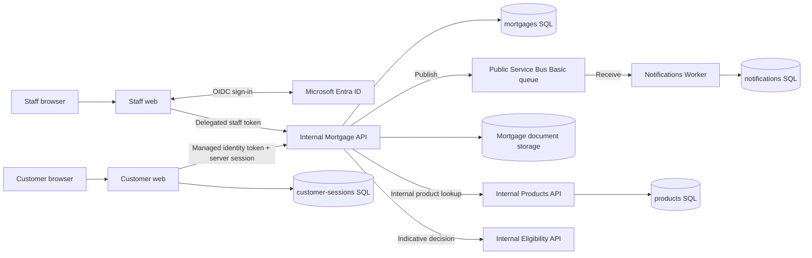
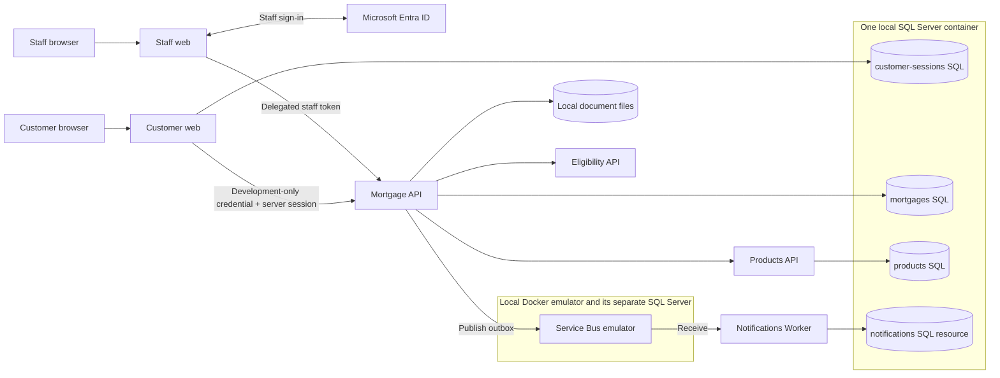
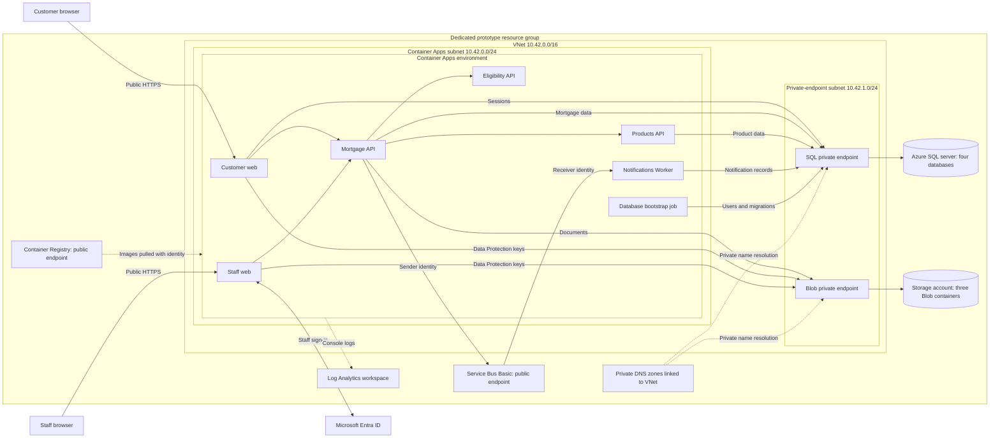
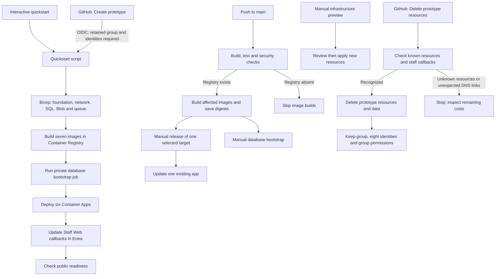

# Architecture

This page explains **what runs where and why**. It is a reference, not a
deployment procedure. For the actual clicks and commands, follow the
[setup-from-scratch guide](azure-setup-from-scratch.md).

## How to read this page

1. Start with **Runtime boundaries** to see how a browser request travels
   through the web apps and APIs.
2. Read **Persistence** to see where data is stored locally and in Azure.
3. Read **Azure deployment** for network boundaries and the create/delete
   lifecycle.
4. Read **Operations and observability** before troubleshooting or enabling
   optional monitoring, which can add costs.

An **API** is a service called by another app. A **managed identity** is an
Azure-provided identity used instead of an application password. A **private
endpoint** gives a service a private network address. An **outbox** is a
database record that lets the API publish a notification later; a **queue**
holds messages until a consumer processes them. A **worker** is a background
program rather than a web page. A **migration** is a versioned database
change. A **replica** is a running copy of an app.

## Project grouping

Open [PD.Mortgages.slnx](../PD.Mortgages.slnx) to browse the projects in
solution folders. These folders are for navigation; the actual project
directories remain at the repository root.

| Solution folder | What it contains |
| --- | --- |
| Mortgages | Mortgage API, its domain, supporting libraries and the mortgage test project |
| Products | Products API, its supporting libraries and tests |
| Eligibility | Eligibility API and contracts |
| Notifications | Notifications Worker |
| User Interfaces | Customer and staff web apps, and customer-session persistence |
| Hosting | Aspire AppHost and the database bootstrap job, which support multiple areas |

The customer web project and directory are
[PD.Mortgages.Customer.Web](../PD.Mortgages.Customer.Web/); the staff project is
[PD.Mortgages.Staff.Web](../PD.Mortgages.Staff.Web/). The customer app still
uses `PD.Mortgages.Web` for its assembly and source namespace, preserving its
application identity and telemetry. Its Azure app and image remain named
`mortgages-web`. The mortgage test project also contains some eligibility and
notification tests. [PD.Shared](../PD.Shared/) holds shared source files; it
is not a separate project.

The Aspire host was renamed from `PD.Mortgages.AppHost` to
[PD.AppHost](../PD.AppHost/). Its existing user-secrets ID was retained.
The former `PD.Mortgages.SharedKernel` is now
[PD.Mortgages.Domain.Types](../PD.Mortgages.Domain.Types/), and its enum
namespace changed from `PD.Mortgages.Domain.Enums` to
`PD.Mortgages.Domain.Types.Enums`. Code outside this repository that references
those project names or enum types must update its references and rebuild.
The Mortgage API's separate wire contracts were not renamed.

## Runtime boundaries

### Azure runtime

The diagram shows the deployed Azure configuration, not the default local
configuration. Service Bus is publicly reachable and uses separate managed
identities for sending and receiving; it is not a private endpoint.

The Mortgage API is the only runtime owner of mortgage applications, audit history and documents. It hosts `PD.Mortgages.Application` and `PD.Mortgages.Infrastructure`; the web apps use `PD.Mortgages.Client` and shared contracts instead. The customer app owns its separate session database; staff has no database because no staff-owned data requires one. Customer and staff Data Protection keys are stored in separate private Blob containers in Azure and accessed by their respective identities.

In Azure, the API checks the customer application's Entra application role and client ID before accepting a server-generated session actor. It validates a staff token's issuer, audience, calling client ID, delegated `Mortgage.Staff` scope, `MortgageStaff` API role and tenant/object IDs. Its application service enforces session ownership, blocks customer access to submitted applications, attributes audit entries, validates document uploads and retains optimistic concurrency and transactional SQL audit writes. Customer submission is idempotent for the same owner, attempt key and expected version. A session-bound receipt exposes only the reference and submission time for 24 hours; other mortgage operations are not automatically retried.

### Local Aspire runtime

Aspire runs the .NET apps locally and creates a process-scoped development
credential for customer-to-API calls. That credential is accepted only in
Development; staff still use Entra sign-in. The local SQL container holds
four logically separate database resources. SQL-backed submissions create
outbox records. By default in Development, Aspire starts a Service Bus emulator,
publisher and worker after license acknowledgement; the worker migrates its
notification database. They can be disabled for a run; see
[local notification processing](../README.md#local-notification-processing).
The emulator uses a separate SQL container and does not test Azure identity or
scaling. Its messages are not retained across container restarts.

#### Follow a local submission

1. A customer or staff member submits an application. The Mortgage API saves
   the submission, audit entry and an outbox record together in `mortgages` SQL.
2. The API checks the outbox roughly every 30 seconds and sends pending events
   to the local emulator. This includes older pending events.
3. The worker receives each event and records a simulated notification in
   `notifications` SQL. It then completes the queue message; **no email is
   sent**. A repeated event does not create another record.
4. To see the result, open the Aspire dashboard and inspect the
   `notifications-worker` logs for `Simulated notification recorded`.
   If the emulator is disabled, events remain pending in SQL instead.

The emulator is a local test tool, not a durable queue. It can lose a message
already marked published in SQL if its container stops before processing it.
See the [local guide](../README.md#local-notification-processing) for setup,
opt-out and troubleshooting.

### Application behaviour

The stateless Eligibility API owns the fictional indicative decision rules; product eligibility remains with Products. Only property value, deposit, income and credit-check consent state are sent, using a distinct shared service key. Mortgage owns the saved decision, rule version and audit event, rechecks application version after the call and rejects stale results. A service failure returns an unavailable response, not a declined decision. Existing decisions without a rule version remain readable. No credit bureau is contacted.

Mortgage records the optional credit-check choice and its consent history. Existing snapshots remain readable: historical consent records are retained, and obsolete snapshot fields are ignored and removed when an application is saved. The consent API now accepts only the credit-check choice; coordinate client and API deployments when changing the contract.

Selected product terms are snapshotted with the application and displayed on customer review and the submitted staff view even if the catalog later changes. The Products API's catalog version is a deterministic per-product content fingerprint, not a monotonic catalog-wide revision; the local mock uses its configured version.
The aggregate requires matching saved terms before submission; a legacy draft without a snapshot must have its product selected again. Historical submitted records without a snapshot remain readable but their original terms cannot be reconstructed.

Deleted and expired drafts leave a minimal tombstone and audit history. SQL marks the draft deleted and records the audit event in one version-checked transaction. API-hosted maintenance retries document deletion and periodically rechecks tombstones for uploads that finished after deletion; it also expires in-progress drafts after 30 days without activity. Submitted applications are excluded.

Staff can look up retained audit history, including deleted drafts, using the full application ID. Upload content is retained when the storage or SQL outcome is ambiguous; only known pre-commit failures and concurrency conflicts are compensated immediately. There is no durable orphan reconciliation for active applications; operators must investigate the logged IDs as described in the README.

The file persistence provider is for development only: unlike SQL, its audit and tombstone writes are not transactional across files.

For both submission paths, SQL saves the status change, audit entry and one minimal outbox event in the same transaction. The API's publisher uses expiring SQL leases to claim pending events, then sends their IDs, application IDs, event type/version and timestamp to one Service Bus queue. A crash after sending but before recording publication can cause a duplicate. The separate worker atomically records one `SimulatedNotifications` row per event in its own database before completing the message; it does not send an email. Invalid messages are dead-lettered; repeated processing failures are eventually dead-lettered by Service Bus. This is at-least-once delivery, not exactly once. Existing submissions are not backfilled. File and in-memory providers do not create outbox events; notifications require SQL.

Mortgage API request and response shapes and their enums live in `PD.Mortgages.Contracts`, which does not reference the domain. The API and typed client use `PD.Mortgages.Transport` to map wire contracts to the models and service interface in `PD.Mortgages.Abstractions`. The application service implements that interface; neither web app nor the client references the application or domain implementation projects. The small `PD.Mortgages.Domain.Types` contains mortgage value enums and their display names, but no entities, persistence or business services. They are shared between layers of the mortgage area, not a shared kernel between separate business contexts.

Products requests have a ten-second total timeout across retries. Eligibility requests have a ten-second timeout without automatic retries. Service timeouts count towards each per-handler circuit breaker; cancellation by the caller does not.

## Persistence

| Runtime | Mortgage and audit | Documents | Product catalog | Customer sessions | Notifications |
| --- | --- | --- | --- | --- | --- |
| Aspire | `mortgages` SQL | Local files under `LocalApplicationData/PD.Mortgages` | `products` SQL | `customer-sessions` SQL | Separate `notifications` SQL; processed by default in Development |
| Standalone API | In-memory by default in Development | In memory with in-memory persistence | Mock catalog by default | Owned by customer app | Disabled by default |
| Azure | `mortgages` Azure SQL | Private Blob container | `products` Azure SQL | `customer-sessions` Azure SQL | Separate `notifications` Azure SQL |

Aspire uses one local SQL Server container and volume for the application databases; they are logically separate. The emulator has a second SQL Server container for its own use. Azure uses four separate serverless databases on one logical SQL server. Each database has its own migration history, and the session cache is created only in the customer-session database. Existing databases with previous migration histories require the data-safe or disposable-local reset procedure in the [migration guidance](../README.md#database-migrations).

In Aspire, the Mortgage API, Products API and customer web app apply their own databases' migrations at startup. The worker applies the notifications database migrations when the local emulator is enabled. The Azure bootstrap applies all four during creation or when explicitly run before dependent releases and copies historical mortgage simulation records idempotently; it does not grant schema-migration permissions to the runtime identities.

## Azure deployment

### Network and hosting

The arrows show logical connections, not every DNS query or network hop. The
customer and staff web apps have public ingress; the three API ingress
endpoints are internal. SQL and Blob are Azure services outside the VNet,
accessed through the private endpoints inside it; their public network access
is disabled. The registry and Service Bus namespace are public endpoints,
with identity-based access. The queue is part of the Service Bus namespace.

The customer and staff web apps have public HTTPS ingress. All three APIs have internal ingress. The Eligibility API has no database and shares a separate secret with Mortgage API. The customer managed identity can access only its session database and customer key container, and is assigned the API application role. The Mortgage API identity can access the mortgage database and document container; the Products API identity has read access to its catalog database. The staff identity accesses its own key container and has no SQL or document access. Staff API authorization uses delegated tokens, not the staff app's managed identity. The quickstart assigns the customer API role; the bootstrap job's managed identity provisions SQL users and applies migrations.

One VNet (`10.42.0.0/16`) contains a delegated Container Apps subnet (`10.42.0.0/24`) and a private-endpoint subnet (`10.42.1.0/24`). SQL and Blob private endpoints use linked private DNS zones; public network access is disabled for both services. The registry and Service Bus Basic namespace remain publicly reachable with identity-based access. The API has queue-scoped sender access; the worker has queue-scoped receiver access and its own SQL identity. A separate scaler identity has namespace-scoped Service Bus Data Owner, as in Microsoft's KEDA example, and is unavailable to application containers (`lifecycle: None`). This is broader than receiver access. Local Service Bus authentication is disabled. The worker has no ingress and is configured for zero to one replicas; scale-from-zero and its permissions still need live validation. Only the two web apps expose external ingress.

This is not a production security boundary: staff ingress is public, and the prototype needs further security, privacy, backup and retention review before handling real data. The in-memory staff token cache is lost on restart; staff may be prompted to sign in again. A customer-to-staff journey and simulated notification were observed using the earlier API-hosted consumer; the separate worker and scale rule have not yet been tested live. See the [prototype lifecycle guide](../AZURE_PROTOTYPE_GUIDE.md) for create/delete and identity setup, and the [advanced deployment guide](azure-advanced-deployment.md) for cost notes and operational details.

### Creation, updates and deletion

The on-demand create workflow uses the same quickstart script as an
interactive deployment, but does not create a missing group, identities or
customer app-role assignment. Entra registrations and GitHub configuration
are outside the group and remain after normal deletion. The delete workflow
removes the current staff callback URIs before deleting recognized resources;
an error after deletion starts can leave a partially deleted, billable
environment. It permanently deletes databases, blobs, queue data, images and
logs. There is no verified whole-environment pause.

Push-to-main builds do not deploy. Separate manual workflows verify a
successful build's digest and update one existing app or explicitly run the
bootstrap job. A separate reviewed preview/apply path is limited to creating
new resources, not updates to existing definitions; what-if is not a guarantee.
Image builds and GitHub lifecycle, release and infrastructure workflows share a
concurrency group, but manual quickstart runs do not. For the required setup
and step-by-step operation, see the
[prototype lifecycle guide](../AZURE_PROTOTYPE_GUIDE.md).

## Operations and observability

The five web/API apps log request route, status, duration and W3C trace/span IDs; HTTP clients propagate the trace context between services. The worker logs processing and failures separately. The existing Log Analytics workspace retains logs for 30 days and is charged by ingestion. Avoid logging request bodies, tokens or personal data. Correlate a journey by searching `ContainerAppConsoleLogs_CL` for its trace ID. Request counters are emitted as .NET meters, but this deployment does not configure a metrics exporter.

An optional `otlpEndpoint` enables OpenTelemetry HTTP server and client span export to a trusted, separately provisioned OTLP collector; it is off by default. The endpoint must use HTTPS outside Development and cannot contain credentials. Set `otlpProtocol` to `grpc` (the default) or `http/protobuf` to match the collector. Root traces are sampled at 10%, with downstream services honoring the parent decision. URL path and query tags are removed before export, but telemetry can still contain operational metadata: assess the destination, security and retention before enabling it. An Azure Monitor connection string is not an OTLP collector endpoint. Collector and ingestion costs are additional; test connectivity and data handling before relying on traces.

Liveness checks only the process; readiness checks required dependencies. Health probes are exempt from the Products API rate limiter. Customer web readiness includes the Mortgage API and its configured distributed session store. Separately, the rate-limited `/health/dependencies` customer endpoint checks Products and Eligibility through the Mortgage API using their configured service credentials.

The manual single-app release checks public readiness for the selected web
app only. It does not test internal APIs, the worker, or `/health/dependencies`.
The interactive quickstart and on-demand creation check public readiness.
None of these checks exercise staff sign-in or complete business flows.

Regular SQL readiness probes and maintenance may keep databases active; the template requests the SQL free offer with auto-pause on allowance exhaustion, which makes the database unavailable until the next month. Setting `alertEmail` provisions an optional paid five-minute Azure Monitor log alert for repeated 5xx responses and an email action group; it is disabled by default. The alert depends on console-log ingestion and does not detect a complete logging outage. Verify delivery in Azure and add an independent availability/replica alert before relying on the demo. Review ingestion, alert frequency and retention costs. Follow the [restore exercise](../README.md#restore-exercise) and migration guidance before deploying future schema changes.
