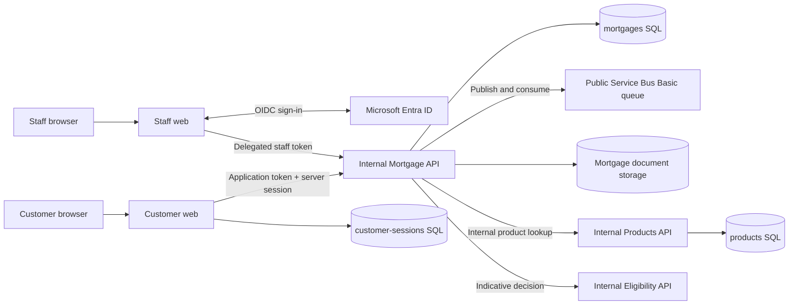
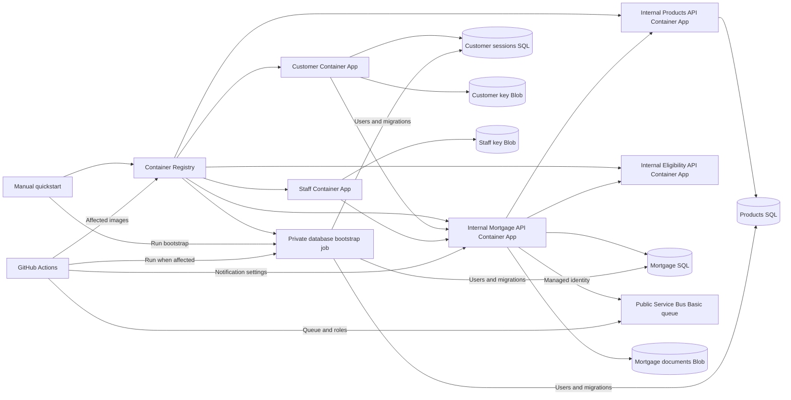

# Architecture

## Runtime boundaries

The Mortgage API is the only runtime owner of mortgage applications, audit history and documents. It hosts `PD.Mortgages.Application` and `PD.Mortgages.Infrastructure`; the web apps use `PD.Mortgages.Client` and shared contracts instead. The customer app owns its separate session database; staff has no database because no staff-owned data requires one. Customer and staff Data Protection keys are stored in separate private Blob containers in Azure and accessed by their respective identities.

The API checks the customer application's Entra application role and client ID before accepting a server-generated session actor. It validates a staff token's issuer, audience, calling client ID, delegated `Mortgage.Staff` scope, `MortgageStaff` API role and tenant/object IDs. Its application service enforces session ownership, blocks customer access to submitted applications, attributes audit entries, validates document uploads and retains optimistic concurrency and transactional SQL audit writes. Customer submission is idempotent for the same owner, attempt key and expected version. A session-bound receipt exposes only the reference and submission time for 24 hours; other mortgage operations are not automatically retried.

The stateless Eligibility API owns the fictional indicative decision rules; product eligibility remains with Products. Only property value, deposit, income and credit-check consent state are sent, using a distinct shared service key. Mortgage owns the saved decision, rule version and audit event, rechecks application version after the call and rejects stale results. A service failure returns an unavailable response, not a declined decision. Existing decisions without a rule version remain readable. No credit bureau is contacted.

Mortgage records the optional credit-check choice and its consent history. Existing snapshots remain readable: historical consent records are retained, and obsolete snapshot fields are ignored and removed when an application is saved. The consent API now accepts only the credit-check choice; coordinate client and API deployments when changing the contract.

Selected product terms are snapshotted with the application and displayed on customer review and the submitted staff view even if the catalog later changes. The Products API's catalog version is a deterministic per-product content fingerprint, not a monotonic catalog-wide revision; the local mock uses its configured version.
The aggregate requires matching saved terms before submission; a legacy draft without a snapshot must have its product selected again. Historical submitted records without a snapshot remain readable but their original terms cannot be reconstructed.

Deleted and expired drafts leave a minimal tombstone and audit history. SQL marks the draft deleted and records the audit event in one version-checked transaction. API-hosted maintenance retries document deletion and periodically rechecks tombstones for uploads that finished after deletion; it also expires in-progress drafts after 30 days without activity. Submitted applications are excluded.

Staff can look up retained audit history, including deleted drafts, using the full application ID. Upload content is retained when the storage or SQL outcome is ambiguous; only known pre-commit failures and concurrency conflicts are compensated immediately. There is no durable orphan reconciliation for active applications; operators must investigate the logged IDs as described in the README.

The file persistence provider is for development only: unlike SQL, its audit and tombstone writes are not transactional across files.

For both submission paths, SQL saves the status change, audit entry and one minimal outbox event in the same transaction. The API's publisher uses expiring SQL leases to claim pending events, then sends their IDs, application IDs, event type/version and timestamp to one Service Bus queue. A crash after sending but before recording publication can cause a duplicate. The consumer atomically records one `SimulatedNotifications` row per event before completing the message; it does not send an email. Invalid messages are dead-lettered; repeated processing failures are eventually dead-lettered by Service Bus. This is at-least-once delivery, not exactly once. Existing submissions are not backfilled. File and in-memory providers do not create outbox events; notification workers are disabled by default locally and require SQL.

Mortgage API request and response shapes and their enums live in `PD.Mortgages.Contracts`, which does not reference the domain. The API and typed client use `PD.Mortgages.Transport` to map wire contracts to the models and service interface in `PD.Mortgages.Abstractions`. The application service implements that interface; neither web app nor the client references the application or domain implementation projects. The small `PD.Mortgages.SharedKernel` contains shared mortgage value enums and their display names, but no entities, persistence or business services. Its existing `PD.Mortgages.Domain.Enums` namespace is retained for compatibility.

Products requests have a ten-second total timeout across retries. Eligibility requests have a ten-second timeout without automatic retries. Service timeouts count towards each per-handler circuit breaker; cancellation by the caller does not.

## Persistence

| Runtime | Mortgage and audit | Documents | Product catalog | Customer sessions |
| --- | --- | --- | --- | --- |
| Aspire | `mortgages` SQL | Local files under `LocalApplicationData/PD.Mortgages` | `products` SQL | `customer-sessions` SQL |
| Standalone API | In-memory by default in Development | In memory with in-memory persistence | Mock catalog by default | Owned by customer app |
| Azure | `mortgages` Azure SQL | Private Blob container | `products` Azure SQL | Separate `customer-sessions` Azure SQL |

Aspire uses one local SQL Server container and volume for all three databases; they are logically separate. Azure uses separate serverless databases on one logical SQL server. Each database has its own newly reset initial migration, and the session cache is created only in the customer-session database. Existing databases with previous migration histories require the data-safe or disposable-local reset procedure in the [migration guidance](../README.md#database-migrations).

In Aspire, the Mortgage API, Products API and customer web app apply their own databases' migrations at startup. The Azure bootstrap applies all three before app deployment, rather than granting schema-migration permissions to the runtime identities.

## Azure deployment

The customer and staff web apps have public HTTPS ingress. All three APIs have internal ingress. The Eligibility API has no database and shares a separate secret with Mortgage API. The customer managed identity can access only its session database and customer key container, and is assigned the API application role. The Mortgage API identity can access the mortgage database and document container; the Products API identity has read access to its catalog database. The staff identity accesses its own key container and has no SQL or document access. Staff API authorization uses delegated tokens, not the staff app's managed identity. The quickstart assigns the customer API role; the bootstrap job's managed identity provisions SQL users and applies migrations.

One VNet (`10.42.0.0/16`) contains a delegated Container Apps subnet (`10.42.0.0/24`) and a private-endpoint subnet (`10.42.1.0/24`). SQL and Blob private endpoints use linked private DNS zones; public network access is disabled for both services. The registry and Service Bus Basic namespace remain publicly reachable with identity-based access. The API identity has sender and receiver permissions scoped to the queue; local Service Bus authentication is disabled. Hosting both workers in the API avoids another always-on Container App but sacrifices independent scaling and identity isolation. The Container Apps environment has public ingress enabled, but only the two web apps expose external ingress.

This is not a production security boundary: staff ingress is public, and the prototype needs further security, privacy, backup and retention review before handling real data. The in-memory staff token cache is lost on restart; staff may be prompted to sign in again. The manual quickstart provisions the core infrastructure; GitHub Actions deploys the notification queue and settings and updates changed images on existing resources. An initial app-only GitHub deployment succeeded with readiness and dependency checks; the notification pipeline and complete customer-to-staff journey remain unvalidated. See the [Azure deployment guide](../AZURE_DEPLOYMENT.md) for identity setup, migration implications and cost notes.

## Operations and observability

All five apps log request route, status, duration and W3C trace/span IDs; HTTP clients propagate the trace context between services. The existing Log Analytics workspace retains logs for 30 days and is charged by ingestion. Avoid logging request bodies, tokens or personal data. Correlate a journey by searching `ContainerAppConsoleLogs_CL` for its trace ID. Request counters are emitted as .NET meters, but this deployment does not configure a metrics exporter.

An optional `otlpEndpoint` enables OpenTelemetry HTTP server and client span export to a trusted, separately provisioned OTLP collector; it is off by default. The endpoint must use HTTPS outside Development and cannot contain credentials. Set `otlpProtocol` to `grpc` (the default) or `http/protobuf` to match the collector. Root traces are sampled at 10%, with downstream services honoring the parent decision. URL path and query tags are removed before export, but telemetry can still contain operational metadata: assess the destination, security and retention before enabling it. An Azure Monitor connection string is not an OTLP collector endpoint. Collector and ingestion costs are additional; test connectivity and data handling before relying on traces.

Liveness checks only the process; readiness checks required dependencies. Health probes are exempt from the Products API rate limiter. Customer web readiness includes the Mortgage API and its configured distributed session store. Separately, the rate-limited `/health/dependencies` customer endpoint checks Products and Eligibility through the Mortgage API using their configured service credentials; the GitHub workflow runs this on demand after deployment, not on every probe. It does not exercise staff sign-in or complete business flows. Regular SQL readiness probes and maintenance may keep databases active; the template requests the SQL free offer with auto-pause on allowance exhaustion, which makes the database unavailable until the next month. Setting `alertEmail` provisions an optional paid five-minute Azure Monitor log alert for repeated 5xx responses and an email action group; it is disabled by default. The alert depends on console-log ingestion and does not detect a complete logging outage. Verify delivery in Azure and add an independent availability/replica alert before relying on the demo. Review ingestion, alert frequency and retention costs. Follow the [restore exercise](../README.md#restore-exercise) and migration guidance before deploying future schema changes.
