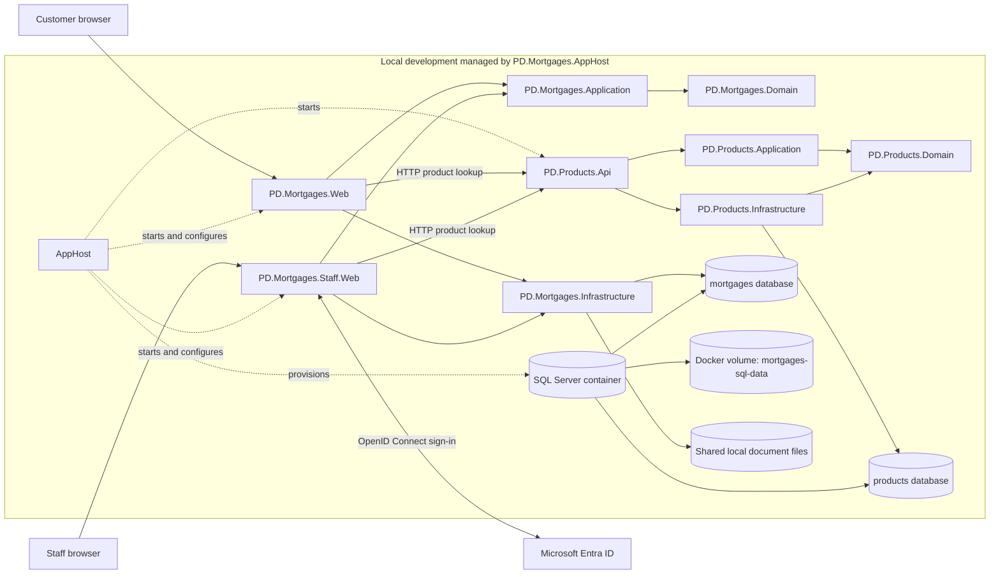
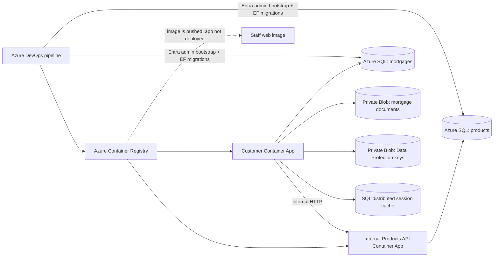

# Architecture

This page describes the current solution structure, local Aspire setup, persistence modes, and Azure deployment.

## Local Aspire runtime

The customer and staff web apps share SQL application and audit data in the `mortgages` database. The Products API stores its catalog in the separate `products` database and seeds it with the current example products during migration. Both databases use the same local SQL Server container and named volume. Document contents are stored separately as files under the host's `LocalApplicationData/PD.Mortgages` directory. The customer wizard's session state uses the local in-memory cache.

## Application layers

- **PD.Mortgages.Web** and **PD.Mortgages.Staff.Web** are separate MVC front ends.
- **PD.Mortgages.Application** coordinates mortgage use cases, consent history, and shared document-upload validation; it depends on domain contracts.
- **PD.Mortgages.Domain** contains mortgage entities, rules, attributed/versioned consent records, and repository/storage interfaces.
- **PD.Mortgages.Infrastructure** implements in-memory, file, and SQL Server persistence, SQL-backed audit transactions, Azure Blob document/Data Protection storage, and the Products API client.
- **PD.Products.Api** exposes the product catalog over HTTP and uses the separate `PD.Products.Application`, `PD.Products.Domain`, and `PD.Products.Infrastructure` projects. It uses SQL in Aspire and Azure; standalone runs use an in-memory catalog.
- **PD.Mortgages.AppHost** orchestrates the local web apps, Products API, and SQL Server container; it is not required for standalone project runs.

Staff MVC routes require an authenticated Entra identity with the `MortgageStaff` app role. The staff actor uses the tenant and object IDs from the validated identity for audit attribution. Customer sign-in is not configured in this demonstration.

## Persistence by run mode

| Run mode | Mortgage applications and audit | Document contents | Product catalog | Session state |
| --- | --- | --- | --- | --- |
| Aspire local | Shared `mortgages` SQL database | Shared local files | Separate `products` SQL database | Customer wizard session in memory |
| Customer web standalone | In memory | In memory | In-process mock | In memory |
| Staff web standalone | Files under `data` | Files under `data` | In-process mock | No staff wizard session |
| Current Azure deployment | Azure SQL `mortgages` database | Private Azure Blob container | Azure SQL `products` database | SQL distributed cache; Data Protection keys in private Blob container |

The mortgage and product EF Core `InitialCreate` migrations are baselines for fresh databases. The mortgage session-cache migration follows its baseline; both remain in history so existing databases can upgrade. The deployment bootstrap applies migrations before app deployment, not in Azure application replicas. The SQL-backed audit write commits an application change and its audit event in one transaction. File/in-memory providers remain local/demo options. Tests do not connect to SQL Server; see the [test notes in the README](../README.md#tests).

## Current Azure deployment

The pipeline builds and pushes images for all three projects, but deploys only the customer app and internal Products API. Azure SQL is Entra-only: the pipeline service principal bootstraps the two application identities and applies EF migrations; runtime identities are separately scoped, with product-catalog read access and mortgage-data read/write access. Blob shared-key access and anonymous container access are disabled. The SQL server and Blob endpoint currently use Azure public endpoints with Azure SQL's trusted-Azure-services firewall rule; use private endpoints/VNet integration before a production deployment.

The staff image still has no Container App deployment or production Entra configuration. Both portals support persistent Data Protection keys when `DataProtection:BlobUri` is configured; the mortgage app is configured to use its Blob key object in Azure. Customer authentication remains intentionally unconfigured in this demonstration: production configuration still requires an authenticated customer, so the customer journey is not usable until a customer identity scheme is implemented.
