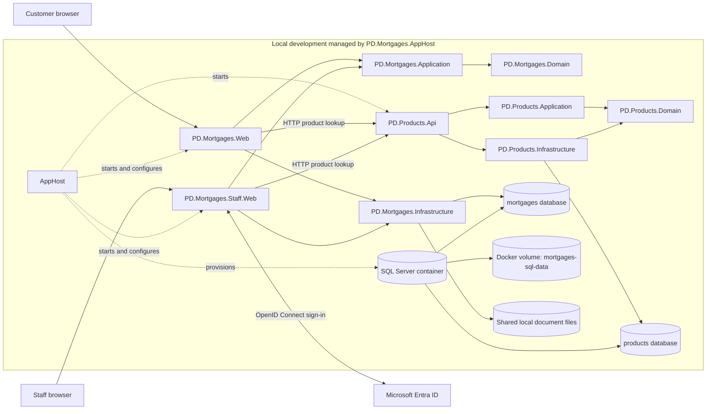
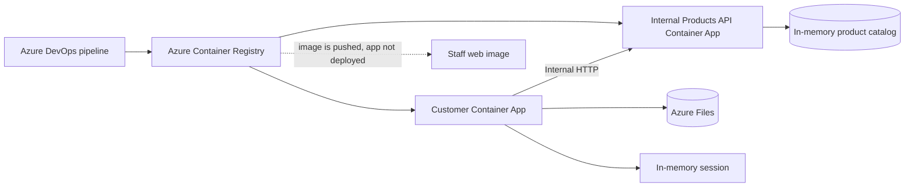

# Architecture

This page describes the current solution structure, local Aspire setup, persistence modes, and Azure deployment. Azure SQL and Blob Storage are future production options, not part of the current deployment.

## Local Aspire runtime

The customer and staff web apps share SQL application and audit data in the `mortgages` database. The Products API stores its catalog in the separate `products` database and seeds it with the current example products during migration. Both databases use the same local SQL Server container and named volume. Document contents are stored separately as files under the host's `LocalApplicationData/PD.Mortgages` directory. The customer wizard's session state is held in the customer web process.

## Application layers

- **PD.Mortgages.Web** and **PD.Mortgages.Staff.Web** are separate MVC front ends.
- **PD.Mortgages.Application** coordinates mortgage use cases and depends on domain contracts.
- **PD.Mortgages.Domain** contains mortgage entities, rules, and repository/storage interfaces.
- **PD.Mortgages.Infrastructure** implements in-memory, file, and SQL Server persistence, document storage, and the Products API client.
- **PD.Products.Api** exposes the product catalog over HTTP and uses the separate `PD.Products.Application`, `PD.Products.Domain`, and `PD.Products.Infrastructure` projects. It uses SQL in Aspire and an in-memory catalog in standalone and Azure modes.
- **PD.Mortgages.AppHost** orchestrates the local web apps, Products API, and SQL Server container; it is not required for standalone project runs.

Staff MVC routes require an authenticated Entra identity with the `MortgageStaff` app role. The staff actor uses the tenant and object IDs from the validated identity for audit attribution. Customer sign-in is not configured in this demonstration.

## Persistence by run mode

| Run mode | Mortgage applications and audit | Document contents | Product catalog | Session state |
| --- | --- | --- | --- | --- |
| Aspire local | Shared `mortgages` SQL database | Shared local files | Separate `products` SQL database | Customer wizard session in memory |
| Customer web standalone | In memory | In memory | In-process mock | In memory |
| Staff web standalone | Files under `data` | Files under `data` | In-process mock | No staff wizard session |
| Current Azure deployment | Customer records and documents in Azure Files via file persistence | Azure Files | Internal Products API's in-memory catalog | Customer session in memory; one customer replica |

The mortgage and product EF Core `InitialCreate` migrations are baselines for fresh databases; they do not upgrade older schemas. Tests do not connect to SQL Server; see the [test notes in the README](../README.md#tests).

## Current Azure deployment

The pipeline builds and pushes images for all three projects, but deploys only the customer app and internal Products API. The customer app currently uses file-backed persistence on Azure Files, not Azure SQL. The deployed Products API uses its in-memory catalog; the local `products` database is not deployed. The staff image has no Container App deployment or production Entra configuration yet. Production hardening also requires persistent Data Protection keys and real customer authentication. Azure SQL for application/audit data and Blob Storage for documents are possible future changes, not current resources.
